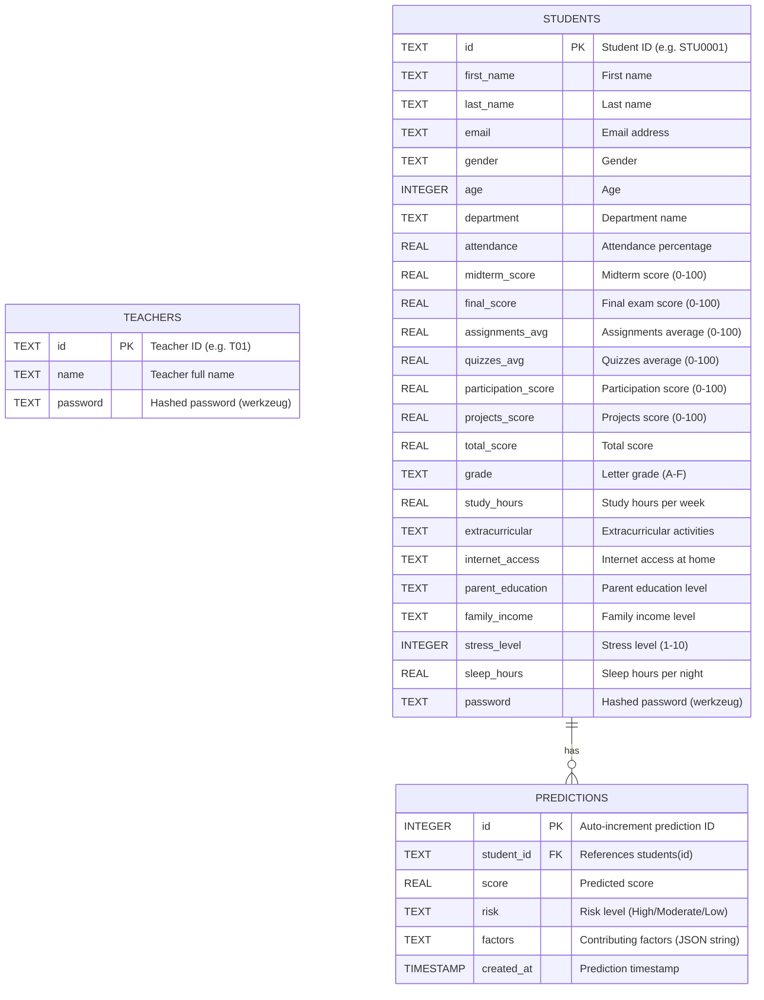
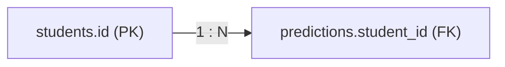

# RISKRADAR
# DATABASE DESIGN AND ENTITY-RELATIONSHIP DIAGRAM

**Project Name:** RiskRadar – Student Performance Prediction & Academic Risk Detection System  
**Team Members:** Ronit Pednekar, Manas Parab, Usman Khan  
**Programme:** MSc Integrated Data Science — SEM 5  
**Subject:** Software Engineering  
**Institution:** Goa University  
**Document Version:** 1.0  
**Date:** 18 November 2026

---

# 1. INTRODUCTION

## 1.1 Purpose

This document describes the database design of RiskRadar. It presents the Entity-Relationship Diagram (ERD), table structures, field descriptions, data types, primary and foreign key relationships, and seeding strategy.

## 1.2 Scope

RiskRadar uses SQLite as its embedded relational database. The database stores teacher accounts, student records and prediction history.

The database is created and seeded automatically on first application startup using the init_db() and seed_db() functions in database.py.

# 2. DATABASE MANAGEMENT SYSTEM

| Property | Value |
|---|---|
| DBMS | SQLite |
| Database File | riskradar.db |
| Access Method | Python sqlite3 module |
| Journal Mode | WAL (Write-Ahead Logging) |
| Row Factory | sqlite3.Row (dictionary-style access) |

SQLite was selected because:

- It is an embedded database requiring no separate server process.
- It is included in Python's standard library.
- It is suitable for the application's data volume (5,000 students).
- It simplifies deployment (single file).

# 3. ENTITY-RELATIONSHIP DIAGRAM

# 4. TABLE DESCRIPTIONS

## 4.1 Teachers Table

The teachers table stores teacher account credentials.

| Column | Data Type | Constraint | Description |
|---|---|---|---|
| id | TEXT | PRIMARY KEY | Unique teacher identifier (e.g. T01) |
| name | TEXT | NOT NULL | Teacher full name |
| password | TEXT | NOT NULL | Hashed password (werkzeug) |

**Seeded Data:**

One teacher account is created during database seeding:

| Field | Value |
|---|---|
| ID | T01 |
| Name | Admin Teacher |
| Password | admin123 (stored as hash) |

## 4.2 Students Table

The students table stores comprehensive student records loaded from the CSV dataset.

| Column | Data Type | Constraint | Description |
|---|---|---|---|
| id | TEXT | PRIMARY KEY | Unique student identifier (e.g. STU0001) |
| first_name | TEXT | NOT NULL | Student first name |
| last_name | TEXT | NOT NULL | Student last name |
| email | TEXT | | Student email address |
| gender | TEXT | | Gender |
| age | INTEGER | | Student age |
| department | TEXT | | Academic department |
| attendance | REAL | | Attendance percentage |
| midterm_score | REAL | | Midterm exam score (0–100) |
| final_score | REAL | | Final exam score (0–100) |
| assignments_avg | REAL | | Assignments average (0–100) |
| quizzes_avg | REAL | | Quizzes average (0–100) |
| participation_score | REAL | | Class participation score (0–100) |
| projects_score | REAL | | Projects score (0–100) |
| total_score | REAL | | Computed total score |
| grade | TEXT | | Letter grade (A, B, C, D, F) |
| study_hours | REAL | | Study hours per week |
| extracurricular | TEXT | | Extracurricular activities |
| internet_access | TEXT | | Internet access at home |
| parent_education | TEXT | | Parent education level |
| family_income | TEXT | | Family income level |
| stress_level | INTEGER | | Stress level (1–10) |
| sleep_hours | REAL | | Sleep hours per night |
| password | TEXT | NOT NULL | Hashed password (werkzeug) |

**Seeded Data:**

5,000 student records are loaded from students.csv. Passwords are generated as `{first_name_lower}@{id_number}` and stored as hashes.

Example: Student STU0001 with first name "John" gets password `john@0001`.

## 4.3 Predictions Table

The predictions table stores prediction history for each student.

| Column | Data Type | Constraint | Description |
|---|---|---|---|
| id | INTEGER | PRIMARY KEY AUTOINCREMENT | Unique prediction identifier |
| student_id | TEXT | FOREIGN KEY → students(id) | Student being predicted |
| score | REAL | NOT NULL | Predicted score |
| risk | TEXT | NOT NULL | Risk level classification |
| factors | TEXT | | Contributing factors (JSON string) |
| created_at | TIMESTAMP | DEFAULT CURRENT_TIMESTAMP | Prediction creation time |

**Risk Classification:**

| Risk Level | Score Range |
|---|---|
| High | < 60 |
| Moderate | 60 – 70 |
| Low | ≥ 70 |

**Seeded Data:**

5,000 initial prediction records are created from the Total_Score column in students.csv during database seeding, providing baseline predictions for all students.

# 5. RELATIONSHIPS

## 5.1 Students → Predictions (One-to-Many)

- One student can have many predictions.
- Each prediction belongs to exactly one student.
- The student_id foreign key in predictions references the id primary key in students.
- New predictions are added each time a teacher runs a prediction for a student.

## 5.2 Teachers (Standalone)

The teachers table has no foreign key relationships. Teachers are authenticated independently and interact with students and predictions through the application logic.

# 6. PRIMARY KEY AND FOREIGN KEY MAPPING

| Table | Primary Key | Foreign Keys |
|---|---|---|
| teachers | id (TEXT) | None |
| students | id (TEXT) | None |
| predictions | id (INTEGER, AUTOINCREMENT) | student_id → students(id) |

# 7. DATABASE OPERATIONS

## 7.1 Connection Management

The get_db() function in database.py returns a configured SQLite connection:

- Sets row_factory to sqlite3.Row for dictionary-style access.
- Enables WAL journal mode for concurrent read performance.
- Returns a new connection per call.

## 7.2 Schema Creation

The init_db() function creates all three tables using CREATE TABLE IF NOT EXISTS statements. This is idempotent and safe to call on every application startup.

## 7.3 Data Seeding

The seed_db() function:

1. Checks if the students table is empty.
2. If empty, reads students.csv using pandas.
3. Inserts 5,000 student records with hashed passwords.
4. Creates one teacher account (T01 / admin123).
5. Creates 5,000 initial predictions from the CSV Total_Score column.
6. If the table already contains data, seeding is skipped.

## 7.4 Key Database Queries

| Operation | SQL Pattern |
|---|---|
| Authenticate user | `SELECT * FROM {table} WHERE id = ?` |
| Get all students with latest score | `SELECT s.*, p.score, p.risk FROM students s LEFT JOIN (subquery) p ON s.id = p.student_id` |
| Get dashboard stats | `SELECT risk, COUNT(*) FROM predictions GROUP BY risk` |
| Get recent predictions | `SELECT ... FROM predictions JOIN students ORDER BY created_at DESC LIMIT 5` |
| Save prediction | `INSERT INTO predictions (student_id, score, risk, factors) VALUES (?, ?, ?, ?)` |
| Get student history | `SELECT * FROM predictions WHERE student_id = ? ORDER BY created_at` |
| Get latest prediction | `SELECT * FROM predictions WHERE student_id = ? ORDER BY created_at DESC LIMIT 1` |

# 8. DATA VOLUME

| Table | Record Count | Description |
|---|---|---|
| teachers | 1 | Single admin teacher account |
| students | 5,000 | Loaded from students.csv |
| predictions | 5,000+ | Initial seed + new predictions |

The dataset spans 4 departments and includes students with grades A through F.

**Grade Distribution:**

| Grade | Count |
|---|---|
| A | 16 |
| B | 638 |
| C | 2,307 |
| D | 1,760 |
| F | 279 |

**Risk Distribution (from initial seeding):**

| Risk Level | Count | Percentage |
|---|---|---|
| High | 279 | 5.6% |
| Moderate | 1,760 | 35.2% |
| Low | 2,961 | 59.2% |

# 9. CONCLUSION

The RiskRadar database uses SQLite with three tables — teachers, students and predictions — to support user authentication, student record management and prediction history tracking.

The one-to-many relationship between students and predictions enables historical tracking of prediction scores over time, supporting the history and dashboard features.

The database is automatically created and seeded from students.csv on first startup, providing a fully populated system with 5,000 students and baseline predictions ready for immediate use.

---

**END OF DOCUMENT**
