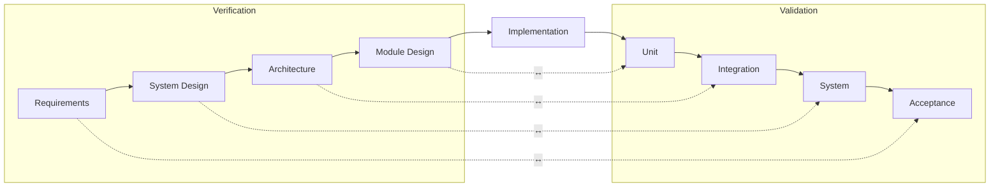
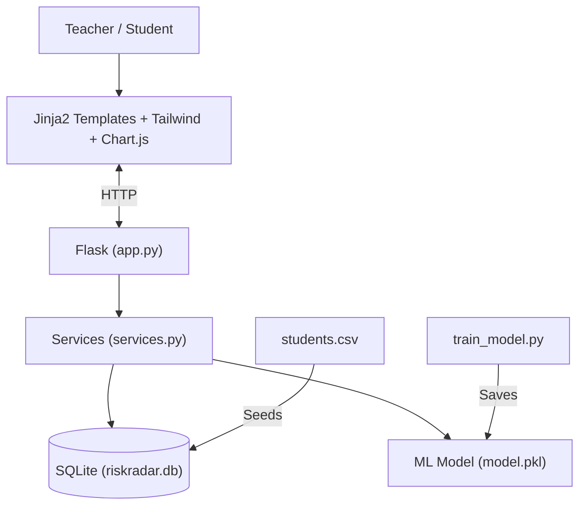
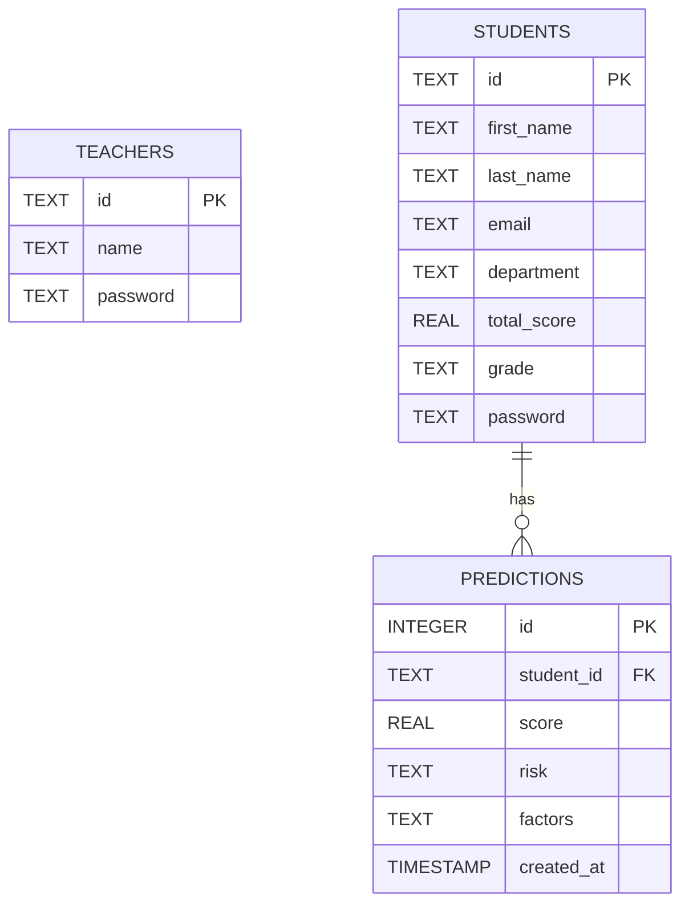

# RISKRADAR
# FINAL PROJECT REPORT

**Project Name:** RiskRadar – Student Performance Prediction & Academic Risk Detection System  
**Team Members:** Ronit Pednekar, Manas Parab, Usman Khan  
**Programme:** MSc Integrated Data Science — SEM 5  
**Subject:** Software Engineering  
**Institution:** Goa University  
**Document Version:** 1.0  
**Date:** 18 November 2026

---

# TABLE OF CONTENTS

1. Introduction
2. Project Overview
3. Technology Stack
4. Software Development Life Cycle
5. System Architecture
6. Database Design
7. Machine Learning Model
8. Backend Development
9. Frontend Development
10. Authentication and Authorization
11. Data Visualization
12. Testing and Verification
13. Performance Analysis
14. Project Structure
15. Deployment and Execution
16. Key Concepts and Technologies
17. Challenges and Solutions
18. Conclusion

---

# 1. INTRODUCTION

## 1.1 Purpose

This report presents the complete documentation of RiskRadar, a Student Performance Prediction and Academic Risk Detection System developed as a university project.

RiskRadar enables university faculty to predict student academic performance using machine learning, identify students at academic risk, and provide actionable recommendations. Students can view their own performance summaries and risk assessments.

## 1.2 Problem Statement

Universities monitor large numbers of students across departments. Identifying students who are at risk of academic failure relies on manual analysis which is time-consuming and inconsistent. Early identification of at-risk students enables timely intervention.

RiskRadar addresses this by applying machine learning to student performance data, automating risk classification and providing a web-based interface for both teachers and students.

## 1.3 Objectives

1. Build a web application for student performance prediction and risk detection.
2. Train a machine learning model on real student academic data.
3. Provide role-based access for teachers and students.
4. Display risk distribution statistics and analytics on a dashboard.
5. Enable individual student performance tracking over time.
6. Support data visualization using interactive charts.
7. Implement responsive design with dark and light mode support.

## 1.4 Team Responsibilities

| Member | Responsibility |
|---|---|
| Ronit Pednekar | Frontend Development (Jinja2 Templates, Tailwind CSS, Chart.js, Responsive Design) |
| Manas Parab | Machine Learning (EDA, Feature Selection, Model Training, Evaluation, Serialization) |
| Usman Khan | Backend Development (Flask, SQLite, Authentication, Services, API Routes) |

---

# 2. PROJECT OVERVIEW

## 2.1 System Description

RiskRadar is a monolithic web application built with Python Flask. It integrates server-side templating, session-based authentication, an SQLite database and a scikit-learn Random Forest model within a single application process.

## 2.2 Key Features

| Feature | Description |
|---|---|
| Role-Based Authentication | Separate login for teachers and students with password hashing |
| Teacher Dashboard | Risk distribution statistics with donut chart and recent predictions |
| ML Prediction | Random Forest Regressor predicts student scores from 7 academic metrics |
| Risk Classification | Automatic classification: High (< 60), Moderate (60–70), Low (≥ 70) |
| Contributing Factors | Feature importance analysis shows which metrics drive each prediction |
| Recommendations | Personalized academic recommendations based on prediction results |
| Student Roster | Searchable, filterable, sortable table of all students |
| Performance History | Individual student prediction history with line chart |
| CSV Upload | Drag-and-drop roster upload with column validation and preview |
| Model Insights | Feature importance visualization and model accuracy information |
| Student Self-Service | Students view their own score, risk level and improvement areas |
| Theme Support | Dark mode and light mode with localStorage persistence |
| Responsive Design | Mobile, tablet and desktop layouts using Tailwind CSS |

## 2.3 Dataset

The application uses a dataset of 5,000 student records with 23 columns:

| Category | Columns |
|---|---|
| Identity | Student_ID, First_Name, Last_Name, Email |
| Demographics | Gender, Age, Department |
| Academic Scores | Attendance, Midterm_Score, Final_Score, Assignments_Avg, Quizzes_Avg, Participation_Score, Projects_Score, Total_Score, Grade |
| Behavioural | Study_Hours_per_Week, Extracurricular_Activities |
| Socioeconomic | Internet_Access_at_Home, Parent_Education_Level, Family_Income_Level |
| Wellbeing | Stress_Level, Sleep_Hours_per_Night |

---

# 3. TECHNOLOGY STACK

## 3.1 Backend

| Technology | Purpose |
|---|---|
| Python 3.12+ | Programming language |
| Flask | Web framework (routes, sessions, request handling) |
| Jinja2 | Server-side HTML templating engine |
| werkzeug.security | Password hashing (generate_password_hash, check_password_hash) |
| sqlite3 | Database access (Python standard library) |
| SQLite | Embedded relational database |

## 3.2 Machine Learning

| Technology | Purpose |
|---|---|
| scikit-learn | RandomForestRegressor model training and evaluation |
| pandas | Data loading, manipulation and EDA |
| NumPy | Numerical operations |
| joblib | Model serialization (save/load model.pkl) |

## 3.3 Frontend

| Technology | Purpose |
|---|---|
| Tailwind CSS (CDN) | Utility-first CSS framework with dark mode |
| Chart.js (CDN) | Donut, line and bar chart visualizations |
| Lucide Icons (CDN) | SVG icon library |
| Inter (Google Fonts) | Typography |
| Vanilla JavaScript | Theme toggle, toast auto-dismiss, sidebar, search/filter/sort |

## 3.4 Development Tools

| Tool | Purpose |
|---|---|
| Git | Version control |
| VS Code | Code editor |
| Chrome DevTools | Browser testing and performance profiling |

---

# 4. SOFTWARE DEVELOPMENT LIFE CYCLE

## 4.1 V-Model

RiskRadar follows the V-Model SDLC framework, linking each development phase to a corresponding testing phase.



| Phase | Activity |
|---|---|
| Requirements Analysis | SRS document with functional and non-functional requirements |
| System Design | Technology selection, architecture decisions |
| Architecture Design | Module identification, data flow design |
| Module Design | Individual function and component design |
| Implementation | Parallel development of ML, Backend and Frontend |
| Unit Testing | Individual function verification |
| Integration Testing | Module interaction verification |
| System Testing | Full application testing against requirements |
| Acceptance Testing | Browser-level workflow verification |

## 4.2 Parallel Workstreams

Development was organized into three parallel workstreams:

1. **ML Workstream (Manas):** EDA, feature selection, model training, evaluation, serialization.
2. **Backend Workstream (Usman):** Database schema, seeding, authentication, services, routes.
3. **Frontend Workstream (Ronit):** Templates, layout, styling, charts, responsive design.

The mock.py contract file defined the expected function signatures and return shapes, enabling frontend development to proceed independently of the backend implementation.

---

# 5. SYSTEM ARCHITECTURE

## 5.1 Architecture Overview

RiskRadar follows a monolithic architecture with the following layers:



## 5.2 Layer Responsibilities

| Layer | Component | Responsibility |
|---|---|---|
| Presentation | Jinja2 Templates | HTML rendering, Tailwind styling, Chart.js visualizations |
| Application | app.py | Route handling, session management, template context |
| Service | services.py | Business logic, ML inference, data retrieval |
| Data Access | database.py | SQLite connection, schema creation, seeding |
| Database | riskradar.db | Persistent storage for teachers, students, predictions |
| ML Pipeline | train_model.py | Model training, evaluation, serialization |

## 5.3 Request Flow

1. Browser sends HTTP request to Flask.
2. Flask route handler checks authentication via login_required decorator.
3. Route handler calls service function(s).
4. Service function queries SQLite and/or runs ML model.
5. Route handler passes data to Jinja2 template.
6. Jinja2 renders HTML response.
7. Browser receives and displays the page.

---

# 6. DATABASE DESIGN

## 6.1 Database Technology

SQLite is used as the embedded relational database. It is accessed via Python's sqlite3 module with WAL journal mode enabled.

## 6.2 Entity-Relationship Diagram



## 6.3 Tables

**Teachers:** 1 record (T01 / admin123). Stores teacher credentials with hashed passwords.

**Students:** 5,000 records loaded from students.csv. Each record includes 23 academic and demographic fields plus a hashed password.

**Predictions:** 5,000 initial records (from CSV Total_Score) plus new predictions added by teachers. Each record stores the predicted score, risk level, contributing factors (JSON) and timestamp.

## 6.4 Seeding Strategy

On first startup:

1. `init_db()` creates tables if they do not exist.
2. `seed_db()` checks if the students table is empty.
3. If empty: loads students.csv, hashes passwords, inserts 5,000 students, creates teacher T01, creates 5,000 initial predictions.
4. If already populated: skips seeding.

---

# 7. MACHINE LEARNING MODEL

## 7.1 Exploratory Data Analysis (EDA)

The dataset of 5,000 students was analysed to understand distributions and patterns.

**Grade Distribution:**

| Grade | Count | Percentage |
|---|---|---|
| A | 16 | 0.3% |
| B | 638 | 12.8% |
| C | 2,307 | 46.1% |
| D | 1,760 | 35.2% |
| F | 279 | 5.6% |

**Risk Distribution:**

| Risk Level | Count | Percentage |
|---|---|---|
| High (< 60) | 279 | 5.6% |
| Moderate (60–70) | 1,760 | 35.2% |
| Low (≥ 70) | 2,961 | 59.2% |

**Department Distribution:** 4 departments across the dataset.

## 7.2 Feature Selection

Seven features were selected as model inputs based on their relevance to academic performance prediction:

1. Midterm_Score
2. Assignments_Avg
3. Quizzes_Avg
4. Participation_Score
5. Projects_Score
6. Attendance (%)
7. Study_Hours_per_Week

**Target Variable:** Total_Score

## 7.3 Algorithm Selection

The Random Forest Regressor was chosen because:

- It handles non-linear relationships between features and the target.
- It provides built-in feature importance through ensemble averaging.
- It is robust to outliers and does not require feature scaling.
- It reduces overfitting through ensemble averaging of multiple decision trees.

## 7.4 Model Training

| Parameter | Value |
|---|---|
| Algorithm | RandomForestRegressor |
| n_estimators | 200 (number of trees) |
| max_depth | 15 (maximum tree depth) |
| random_state | 42 (reproducibility) |
| n_jobs | -1 (use all CPU cores) |
| Train/Test Split | 80/20 |

## 7.5 Model Evaluation

| Metric | Value | Interpretation |
|---|---|---|
| MAE | 3.95 | On average, predictions are within ~4 points of actual scores |
| RMSE | 4.57 | Root mean square error accounting for larger deviations |
| R² | 0.6088 | Model explains ~61% of variance in Total_Score |

## 7.6 Feature Importance

| Rank | Feature | Importance | Interpretation |
|---|---|---|---|
| 1 | Projects_Score | 0.4078 (40.8%) | Strongest predictor of academic performance |
| 2 | Midterm_Score | 0.1799 (18.0%) | Second strongest predictor |
| 3 | Assignments_Avg | 0.1460 (14.6%) | Consistent assignment performance matters |
| 4 | Quizzes_Avg | 0.0913 (9.1%) | Quiz performance contributes moderately |
| 5 | Participation_Score | 0.0839 (8.4%) | Class participation has measurable impact |
| 6 | Study_Hours_per_Week | 0.0457 (4.6%) | Study habits contribute less than assessment scores |
| 7 | Attendance | 0.0454 (4.5%) | Attendance has the smallest individual impact |

## 7.7 Model Serialization

The trained model is serialized using joblib and saved as model.pkl (~60 MB). It is loaded at runtime by the service layer using a global singleton pattern for caching.

## 7.8 Risk Classification

| Risk Level | Score Range | Action |
|---|---|---|
| High | < 60 | Immediate academic intervention required |
| Moderate | 60 – 70 | Student should be monitored closely |
| Low | ≥ 70 | Student performing satisfactorily |

---

# 8. BACKEND DEVELOPMENT

## 8.1 Flask Framework

Flask provides:

- URL routing via decorators (`@app.route`).
- Request handling (GET, POST).
- Session management for authentication.
- Jinja2 template rendering.
- Flash messaging for user feedback.
- Static file serving.

## 8.2 Application Structure

The backend consists of four Python modules:

| Module | Purpose |
|---|---|
| app.py | Flask application, route handlers, session config |
| database.py | SQLite connection, schema, seeding |
| services.py | Business logic, ML inference, data queries |
| mock.py | Contract file with function signatures and fake data |

## 8.3 Route Handlers

| Route | Method | Handler | Access |
|---|---|---|---|
| `/` | GET | Role selection page | Public |
| `/login/<role>` | GET, POST | Authentication | Public |
| `/teacher` | GET | Dashboard | Teacher |
| `/predict` | GET, POST | Prediction form/results | Teacher |
| `/students` | GET | Student roster | Teacher |
| `/history/<student_id>` | GET | Student history | Teacher |
| `/upload` | GET, POST | CSV upload | Teacher |
| `/insights` | GET | Model insights | Teacher |
| `/me` | GET | Student performance | Student |
| `/logout` | GET | Session termination | Authenticated |

## 8.4 Service Functions

| Function | Description |
|---|---|
| `check_login(role, user_id, password)` | Verifies credentials using check_password_hash |
| `get_students()` | JOIN query returning all students with latest prediction |
| `get_dashboard_stats()` | Aggregate risk counts + 5 most recent predictions |
| `predict(student_id, metrics)` | ML inference, risk classification, factor analysis, DB save |
| `get_history(student_id)` | Chronological prediction records for a student |
| `get_latest(student_id)` | Most recent prediction for a student |
| `validate_roster(columns)` | Validates CSV contains required columns |

## 8.5 Database Module

| Function | Description |
|---|---|
| `get_db()` | Returns SQLite connection with Row factory and WAL mode |
| `init_db()` | Creates 3 tables (CREATE TABLE IF NOT EXISTS) |
| `seed_db()` | Loads CSV, hashes passwords, seeds all tables |

## 8.6 Mock Contract Pattern

The mock.py file was created as a development contract:

- Defines the 7 function signatures expected by the frontend.
- Returns fake data with the correct shape (25 hardcoded students).
- Enabled frontend development before the real backend was ready.
- Kept alongside services.py as documentation of the API contract.

---

# 9. FRONTEND DEVELOPMENT

## 9.1 Templating with Jinja2

RiskRadar uses Jinja2 server-side templating with template inheritance.

**Template Hierarchy:**

```
base.html
├── teacher_layout.html
│   ├── dashboard.html
│   ├── predict.html
│   ├── students.html
│   ├── history.html
│   ├── upload.html
│   └── insights.html
├── role_select.html
├── login.html
└── student_me.html
```

**macros.html** provides reusable UI components imported by multiple templates.

## 9.2 Tailwind CSS

Tailwind CSS is loaded via CDN with the following configuration:

- **Dark Mode:** `darkMode: 'class'` — toggled by adding/removing the `dark` class on the HTML element.
- **Color Palette:** Indigo (primary/accent), Zinc (neutral/background), Red/Amber/Emerald (risk indicators).
- **Responsive Breakpoints:** `sm` (640px), `md` (768px), `lg` (1024px).
- **Custom Configuration:** Extended with custom font family (Inter).

## 9.3 Page Descriptions

| Page | Key UI Elements |
|---|---|
| Role Selection | Two role cards with icons, animated hover effects |
| Login | Centered form card, role-specific theming |
| Dashboard | 4 stat cards, donut chart (Chart.js), recent predictions table |
| Predict | Student dropdown, 7 input fields with ranges, result card with risk badge, factors list, recommendations |
| Students | Search bar, risk filter dropdown, sortable table headers, clickable rows |
| History | Student info card, line chart (Chart.js), prediction history table |
| Upload | Drag-and-drop zone, file info display, 5-row CSV preview table |
| Insights | Feature importance horizontal bar chart (Chart.js), model info sections |
| Student Me | Score display, risk badge, progress bar with threshold markers, improvement areas, next steps checklist |

## 9.4 Dark Mode Implementation

1. **No-Flash Script:** An inline script in `<head>` reads localStorage before first paint to set the initial theme class.
2. **Toggle Button:** Calls `toggleTheme()` in app.js which adds/removes the `dark` class and saves to localStorage.
3. **CSS Classes:** All templates use Tailwind's `dark:` variant for dark mode styles.
4. **Color Tokens:** Zinc-900 backgrounds in dark mode, white backgrounds in light mode; Indigo accents throughout.

## 9.5 Client-Side Interactivity

The static/app.js file provides:

- **Theme Toggle:** Switches between dark and light mode.
- **Toast Auto-Dismiss:** Flash messages automatically dismiss after a timeout.
- **Sidebar Toggle:** Hamburger menu for mobile sidebar navigation.

The students.html template includes inline JavaScript for:

- **Search:** Filters table rows by student name or ID as the user types.
- **Filter:** Dropdown to show only High, Moderate or Low risk students.
- **Sort:** Clickable column headers to sort by ID, Name, Department or Score.

The upload.html template includes inline JavaScript for:

- **Drag-and-Drop:** File drop zone with visual feedback.
- **File Preview:** Reads CSV file and displays first 5 rows in a table.
- **Column Validation:** Checks for required columns before submission.

---

# 10. AUTHENTICATION AND AUTHORIZATION

## 10.1 Password Hashing

RiskRadar uses werkzeug.security for password management:

- `generate_password_hash(password)` — Creates a salted hash using the PBKDF2 algorithm.
- `check_password_hash(hash, password)` — Timing-safe comparison of password against stored hash.

Passwords are never stored in plain text. During seeding, student passwords are generated as `{first_name_lower}@{id_number}` and immediately hashed.

## 10.2 Session-Based Authentication

Flask sessions are used for authentication state:

1. On successful login, `session['user_id']`, `session['role']` and `session['name']` are set.
2. The `login_required(role)` decorator checks session state before allowing access.
3. On logout, `session.clear()` terminates the session.
4. Flask signs sessions using the configured `secret_key`.

## 10.3 Access Control Matrix

| Route | Public | Teacher | Student |
|---|---|---|---|
| `/` | Yes | — | — |
| `/login/<role>` | Yes | — | — |
| `/teacher` | — | Yes | No |
| `/predict` | — | Yes | No |
| `/students` | — | Yes | No |
| `/history/<id>` | — | Yes | No |
| `/upload` | — | Yes | No |
| `/insights` | — | Yes | No |
| `/me` | — | No | Yes |
| `/logout` | — | Yes | Yes |

---

# 11. DATA VISUALIZATION

## 11.1 Chart.js Integration

Chart.js is loaded via CDN and used for three chart types:

### Dashboard Donut Chart

- **Type:** Doughnut
- **Data:** High Risk, Moderate Risk, Low Risk counts
- **Colors:** Red (#ef4444), Amber (#f59e0b), Emerald (#10b981)
- **Purpose:** Visual overview of risk distribution

### History Line Chart

- **Type:** Line
- **Data:** Prediction scores over time
- **X-Axis:** Prediction dates
- **Y-Axis:** Scores (0–100)
- **Purpose:** Visualize score progression for individual students

### Insights Feature Importance Bar Chart

- **Type:** Horizontal Bar
- **Data:** 7 feature importance values from the trained model
- **Purpose:** Show which features contribute most to predictions

## 11.2 Jinja2 Data Passing

Chart data is passed from Flask to Chart.js via Jinja2:

```
{{ stats.risk_counts | tojson }}
```

The `tojson` filter safely serializes Python dictionaries to JavaScript-compatible JSON within script tags.

---

# 12. TESTING AND VERIFICATION

## 12.1 Testing Strategy

RiskRadar was tested through manual browser-level functional verification covering all features.

## 12.2 Functional Testing Summary

| Category | Tests | Passed |
|---|---|---|
| Role Selection & Authentication | 6 | 6 |
| Access Control | 4 | 4 |
| Teacher Dashboard | 3 | 3 |
| Student Performance Prediction | 6 | 6 |
| Student Roster | 5 | 5 |
| Student Performance History | 3 | 3 |
| CSV Upload | 3 | 3 |
| Model Insights | 2 | 2 |
| Student Self-Service | 2 | 2 |
| Theme Support | 2 | 2 |
| Responsive Design | 2 | 2 |
| **Total** | **38** | **38** |

**100% pass rate across all 38 test cases.**

Detailed test cases are documented in the Functional Testing Report.

## 12.3 Performance Testing Summary

| Metric | Value |
|---|---|
| Sequential endpoint response | 8–320 ms (warm) |
| First prediction (cold model load) | ~1,200 ms |
| Concurrent users tested | Up to 50 |
| Concurrent success rate | 100% |
| Database query range | 2–120 ms |
| ML inference time | ~8 ms |
| Page full load range | 400–900 ms |

Detailed results are documented in the Performance Testing Report.

---

# 13. PERFORMANCE ANALYSIS

## 13.1 Model Accuracy

The Random Forest Regressor achieves:

- **MAE of 3.95:** Predictions are within ~4 points of actual scores on average.
- **R² of 0.6088:** The model explains ~61% of variance in Total_Score.

This level of accuracy is suitable for academic risk detection where the goal is to identify general risk categories rather than exact scores.

## 13.2 Application Performance

- Flask serves pages within acceptable response times for 5,000 students.
- The model caching strategy eliminates the 60 MB cold-load bottleneck after the first prediction.
- SQLite with WAL mode supports concurrent reads without locking issues.
- CDN-loaded frontend resources benefit from browser caching.

## 13.3 Scalability Considerations

- SQLite is suitable for single-institution deployment (up to ~10,000 students).
- For larger deployments, PostgreSQL or MySQL would be recommended.
- The model caching pattern would work at higher scales.
- The 5,000-row DOM render on the students page could be paginated for larger datasets.

---

# 14. PROJECT STRUCTURE

```
student_performance_prediction/
├── app.py                  # Flask application and route handlers
├── database.py             # SQLite connection, schema, seeding
├── services.py             # Business logic and ML inference
├── train_model.py          # EDA, model training, evaluation
├── mock.py                 # Contract/fallback with function signatures
├── model.pkl               # Trained Random Forest model (~60 MB)
├── students.csv            # Dataset: 5,000 students, 23 columns
├── riskradar.db            # SQLite database (auto-generated)
├── requirements.txt        # Python dependencies
├── run.command             # macOS double-click launcher
├── .gitignore              # Git exclusions
├── static/
│   └── app.js              # Theme toggle, toast, sidebar JS
├── templates/
│   ├── base.html           # Base layout
│   ├── macros.html         # Reusable UI components
│   ├── teacher_layout.html # Sidebar layout for teacher pages
│   ├── role_select.html    # Landing page
│   ├── login.html          # Authentication
│   ├── dashboard.html      # Teacher dashboard
│   ├── predict.html        # Prediction form and results
│   ├── students.html       # Student roster
│   ├── history.html        # Student history
│   ├── upload.html         # CSV upload
│   ├── insights.html       # Model insights
│   └── student_me.html     # Student performance view
└── docs/
    ├── SRS.md
    ├── sdlc_v_model.md
    ├── system_architecture.md
    ├── database_design_and_erd.md
    ├── functional_testing_report.md
    ├── performance_testing_report.md
    └── final_project_report.md
```

---

# 15. DEPLOYMENT AND EXECUTION

## 15.1 Prerequisites

- Python 3.12 or later.
- pip package manager.

## 15.2 Installation

```bash
pip install -r requirements.txt
```

The requirements.txt file contains:

```
flask
pandas
scikit-learn
joblib
```

## 15.3 Model Training (Optional)

To retrain the model:

```bash
python train_model.py
```

This runs EDA, trains the Random Forest model and saves model.pkl.

## 15.4 Running the Application

```bash
python app.py
```

The application starts at http://127.0.0.1:5002.

On macOS, the run.command file provides a double-click launcher.

## 15.5 First Startup Behaviour

On first startup:

1. SQLite database (riskradar.db) is created.
2. Three tables are created.
3. 5,000 students are loaded from students.csv.
4. Teacher account T01 is created.
5. 5,000 initial predictions are created.
6. Flask server starts.

## 15.6 Login Credentials

| Role | ID | Password |
|---|---|---|
| Teacher | T01 | admin123 |
| Student | STU0001 | {first_name_lower}@0001 |
| Student | STU0002 | {first_name_lower}@0002 |
| ... | ... | Pattern: first_name_lower@id_number |

---

# 16. KEY CONCEPTS AND TECHNOLOGIES

## 16.1 Flask Web Framework

Flask is a lightweight Python web framework that provides:

- **Routing:** URL-to-function mapping via decorators.
- **Request Handling:** Access to form data, query parameters, files.
- **Sessions:** Server-side session management for authentication.
- **Templating:** Jinja2 integration for HTML generation.
- **Static Files:** Automatic serving of CSS, JS and image files.
- **Flash Messages:** One-time user feedback messages.

## 16.2 Jinja2 Templating

Jinja2 provides:

- **Template Inheritance:** `` for layout reuse.
- **Blocks:** `` for section overriding.
- **Macros:** `` for reusable components.
- **Filters:** `{{ value | tojson }}` for data transformation.
- **Control Flow:** ``, `` for conditional and loop rendering.

## 16.3 SQLite and sqlite3 Module

SQLite provides:

- **Embedded Database:** No separate server process required.
- **SQL Compliance:** Standard SQL for queries.
- **Row Factory:** Dictionary-style access to query results.
- **WAL Mode:** Write-Ahead Logging for concurrent read performance.
- **Parameterized Queries:** Protection against SQL injection.

## 16.4 werkzeug.security

werkzeug.security provides:

- **generate_password_hash():** Creates salted PBKDF2 hash.
- **check_password_hash():** Timing-safe password verification.
- **Salting:** Each hash includes a unique random salt.
- **Iteration Count:** Configurable for computational cost.

## 16.5 Random Forest Regressor

The Random Forest algorithm:

- **Ensemble Method:** Combines predictions from multiple decision trees.
- **Bagging:** Each tree trains on a bootstrap sample of the data.
- **Feature Randomness:** Each split considers a random subset of features.
- **Feature Importance:** Computed from mean decrease in impurity across trees.
- **Regularization:** max_depth limits tree depth to prevent overfitting.
- **Parallelism:** n_jobs=-1 utilizes all CPU cores for training.

## 16.6 Tailwind CSS

Tailwind CSS provides:

- **Utility Classes:** Composable single-purpose classes (e.g. `bg-indigo-600 text-white p-4`).
- **Dark Mode:** `darkMode: 'class'` enables dark variants (e.g. `dark:bg-zinc-900`).
- **Responsive Design:** Breakpoint prefixes (e.g. `md:grid-cols-2 lg:grid-cols-4`).
- **CDN Delivery:** No build step required.

## 16.7 Chart.js

Chart.js provides:

- **Canvas Rendering:** HTML5 Canvas-based chart rendering.
- **Chart Types:** Doughnut, Line, Bar (horizontal) used in RiskRadar.
- **Responsive:** Charts resize with their container.
- **Animation:** Built-in entry animations.
- **Tooltips:** Interactive hover information.

## 16.8 Exploratory Data Analysis (EDA)

EDA techniques applied:

- **Descriptive Statistics:** Mean, median, standard deviation of numeric columns.
- **Distribution Analysis:** Grade and risk level frequency distributions.
- **Category Counts:** Department distribution.
- **Missing Value Check:** Verification of data completeness.
- **Feature Correlation:** Relationships between input features and target.

## 16.9 Model Evaluation Metrics

| Metric | Formula | Interpretation |
|---|---|---|
| MAE | mean(\|actual - predicted\|) | Average absolute prediction error |
| RMSE | sqrt(mean((actual - predicted)²)) | Penalizes larger errors more heavily |
| R² | 1 - (SS_res / SS_tot) | Proportion of variance explained by the model |

---

# 17. CHALLENGES AND SOLUTIONS

| Challenge | Solution |
|---|---|
| Frontend/backend parallel development | mock.py contract defined expected function signatures and return shapes |
| 60 MB model loading time | Global singleton caching in services.py eliminates repeated loads |
| 5,000 student roster rendering | Client-side search/filter reduces visible rows immediately |
| Password security | werkzeug.security PBKDF2 hashing with per-password salts |
| Theme flashing on page load | Inline no-flash script in HTML head reads localStorage before first paint |
| Concurrent database access | SQLite WAL journal mode enables concurrent reads |
| Cross-role access | login_required(role) decorator enforces role-based routing |

---

# 18. CONCLUSION

RiskRadar successfully integrates web development, database management, authentication, machine learning and data visualization into a cohesive student performance prediction system.

The project demonstrates:

- **ML Pipeline:** EDA, feature selection, Random Forest training, evaluation and deployment.
- **Backend Development:** Flask routing, session authentication, service layer architecture, SQLite database management.
- **Frontend Development:** Jinja2 templating, Tailwind CSS responsive design, Chart.js visualizations, dark mode support.

The system processes 5,000 student records, provides real-time ML predictions, and presents risk analytics through an intuitive web interface accessible to both teachers and students.

All 38 functional test cases passed, and performance testing confirmed acceptable response times under concurrent load.

The V-Model SDLC framework provided structured organisation across the three development workstreams, ensuring traceability between requirements, implementation and testing.

---

**END OF DOCUMENT**
