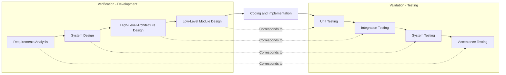

# RISKRADAR
# SOFTWARE DEVELOPMENT LIFE CYCLE – V-MODEL

**Project:** RiskRadar – Student Performance Prediction & Academic Risk Detection System  
**Team Members:** Ronit Pednekar, Manas Parab, Usman Khan  
**Programme:** MSc Integrated Data Science — SEM 5  
**Subject:** Software Engineering  
**Institution:** Goa University  
**SDLC Methodology:** V-Model  
**Document Version:** 1.0  
**Date:** 18 November 2026

---

# 1. INTRODUCTION

## 1.1 Overview

The Software Development Life Cycle (SDLC) defines a structured process for developing, testing and maintaining software applications.

RiskRadar uses the V-Model as its SDLC framework. The V-Model links each development phase to a corresponding testing phase. Verification activities are considered during development, while validation activities are performed as the implemented system is tested.

## 1.2 Objectives

The objectives of using the V-Model for RiskRadar are to:

1. Define the system requirements clearly.
2. Organise development into identifiable phases.
3. Plan testing activities alongside development activities.
4. Maintain traceability between requirements, design decisions and tests.
5. Verify that the implemented application meets its specified requirements.

# 2. WHY THE V-MODEL WAS SELECTED

The V-Model provides a structured process that is suitable for documenting the requirements, design, implementation and testing of RiskRadar. It makes the relationship between development activities and their corresponding testing activities explicit.

The project uses the V-Model as its SDLC framework. The development was divided into three parallel workstreams — Machine Learning model training, Backend development, and Frontend development — with the V-Model applied across the full system.

# 3. V-MODEL REPRESENTATION

The following diagram shows the development and testing phases used to organise RiskRadar.

The corresponding development and testing phases are:

| Development Phase | Corresponding Testing Phase |
|---|---|
| Requirements Analysis | Acceptance Testing |
| System Design | System Testing |
| High-Level Architecture Design | Integration Testing |
| Low-Level Module Design | Unit Testing |
| Coding and Implementation | Implementation point between development and testing |

# 4. DEVELOPMENT PHASES

## 4.1 Requirements Analysis

This phase identifies the expected functions and constraints of RiskRadar.

The requirements include:

- Role-based authentication for teachers and students.
- Password hashing using werkzeug.security.
- Teacher dashboard with risk distribution statistics.
- ML-powered student performance prediction using Random Forest Regression.
- Student roster management with search, filter and sort.
- Individual student performance history tracking.
- CSV roster upload with column validation.
- Model insights and feature importance visualization.
- Student self-service performance view.
- Dark mode and light mode theme support.
- Responsive design across devices.

The Software Requirements Specification (SRS) records the functional and non-functional requirements.

**Corresponding Test Level:** Acceptance testing, which checks whether the delivered system meets user and project requirements.

## 4.2 System Design

This phase defines the overall system structure and the way major parts interact.

RiskRadar uses a monolithic web application structure with:

- A backend developed using Python and Flask.
- Server-side templating using Jinja2.
- Tailwind CSS for frontend styling via CDN.
- Chart.js for data visualization via CDN.
- SQLite as the embedded relational database.
- scikit-learn Random Forest model for predictions.
- werkzeug.security for password hashing.
- Flask sessions for authentication state management.

**Corresponding Test Level:** System testing, which checks the integrated application against its system-level requirements.

## 4.3 High-Level Architecture Design

This phase identifies the major application modules and their interactions.

RiskRadar is organised into the following modules:

| Module | File | Responsibility |
|---|---|---|
| Application Routes | app.py | Flask route handlers, session management, request/response |
| Database Layer | database.py | SQLite connection, table creation, data seeding |
| Service Layer | services.py | Business logic, ML prediction, data retrieval |
| ML Training | train_model.py | EDA, model training, evaluation, serialization |
| Mock Contract | mock.py | Function signatures and expected return shapes |
| Frontend Templates | templates/ | 12 Jinja2 HTML templates |
| Static Assets | static/ | JavaScript (app.js) for theme toggle and UI interactions |

**Corresponding Test Level:** Integration testing, which checks communication and data flow between connected modules.

## 4.4 Low-Level Module Design

This phase describes the internal behaviour of individual modules and functions.

Examples in RiskRadar include:

- Password hashing using generate_password_hash and verification using check_password_hash.
- Flask session creation and role-based access control via login_required decorator.
- Random Forest model loading and caching using global singleton pattern.
- Feature array construction from 7 input metrics for model prediction.
- Risk classification logic: High (< 60), Moderate (60–70), Low (≥ 70).
- Contributing factor calculation using model feature importances.
- Dashboard statistics aggregation using SQL COUNT and GROUP BY.
- Student roster JOIN query with latest prediction subquery.
- CSV column validation for roster upload.
- Client-side search, filter and sort using JavaScript DOM manipulation.
- Theme toggle with localStorage persistence and no-flash script.

**Corresponding Test Level:** Unit testing, which checks individual functions and modules.

## 4.5 Coding and Implementation

The design was implemented using the following technologies:

| Component | Technology |
|---|---|
| Backend Framework | Flask (Python) |
| Templating Engine | Jinja2 |
| CSS Framework | Tailwind CSS (CDN) |
| Charting Library | Chart.js (CDN) |
| Icon Library | Lucide Icons (CDN) |
| Font | Inter (Google Fonts) |
| Database | SQLite |
| ML Library | scikit-learn (RandomForestRegressor) |
| Model Serialization | joblib |
| Data Processing | pandas, NumPy |
| Password Hashing | werkzeug.security |
| Client-side JavaScript | Vanilla JS (app.js) |
| Version Control | Git |

The implementation converts the approved requirements and design into working application components across three workstreams:

1. **ML Workstream:** Dataset exploration (EDA), feature selection, model training, evaluation and serialization.
2. **Backend Workstream:** Database schema, seeding, authentication, service functions, route handlers.
3. **Frontend Workstream:** Base layout, macros, page templates, Chart.js visualizations, theme support, responsive design.

# 5. TESTING PHASES

## 5.1 Unit Testing

Unit tests verify individual functions and modules.

RiskRadar testing activities at the unit level include verification of:

- Password hashing and verification using werkzeug.security.
- Login authentication logic in check_login().
- Risk classification thresholds (< 60, 60–70, ≥ 70).
- Dashboard statistics calculation in get_dashboard_stats().
- Student retrieval with latest predictions in get_students().
- Prediction generation and storage in predict().
- History retrieval for individual students in get_history().
- CSV column validation in validate_roster().
- ML model feature importance ordering.
- Score calculation and risk band assignment.

## 5.2 Integration Testing

Integration testing checks interactions between connected application components.

Areas addressed through integration testing in RiskRadar include:

- Flask routes and service layer communication.
- Service layer and SQLite database operations.
- Model loading from model.pkl and prediction pipeline.
- Jinja2 template rendering with backend data.
- Chart.js visualization with server-provided JSON data.
- Session-based authentication flow across routes.
- CSV upload processing through Flask request handling.
- Database seeding from students.csv on application startup.

## 5.3 System Testing

System testing evaluates the integrated application against its system requirements.

The project test activities cover:

- Role selection and login for both teacher and student roles.
- Teacher dashboard loading with correct statistics.
- Student performance prediction with all 7 input metrics.
- Risk classification and recommendation generation.
- Student roster display with search, filter and sort.
- Individual student history with line chart visualization.
- CSV upload with file preview and validation.
- Model insights page with feature importance chart.
- Student self-service performance view.
- Theme toggle between dark and light modes.
- Responsive layout across different screen sizes.
- Logout and session termination.

Functional and performance testing activities are documented in separate reports.

## 5.4 Acceptance Testing

Acceptance testing evaluates whether the completed application supports the intended user workflows.

Browser-level functional verification was performed using the application interface.

The following workflows were successfully tested:

### Teacher Workflow

1. Teacher selects the "Teacher" role on the landing page.
2. Teacher logs in with Teacher ID (T01) and password.
3. The dashboard displays total students, risk distribution counts and donut chart.
4. The dashboard shows the 5 most recent predictions.
5. Teacher navigates to Predict and selects a student.
6. Teacher enters 7 academic metrics and submits the prediction.
7. The system displays predicted score, risk level, contributing factors and recommendations.
8. Teacher navigates to Students and views the searchable roster.
9. Teacher uses search, filter by risk level, and sort by column.
10. Teacher clicks a student row to view their prediction history.
11. The history page displays a line chart and prediction table.
12. Teacher navigates to Upload and uses the drag-and-drop CSV interface.
13. Teacher views the Insights page with feature importance chart.
14. Teacher logs out successfully.

### Student Workflow

1. Student selects the "Student" role on the landing page.
2. Student logs in with Student ID and password.
3. The student performance page displays their latest score and risk level.
4. The page shows a progress bar with threshold markers.
5. Areas for improvement and next steps are displayed (if at risk).
6. Student logs out successfully.

### Cross-Cutting Verification

- Direct access to teacher routes without login redirects to the login page.
- Direct access to student routes without login redirects to the login page.
- Teacher cannot access student routes and vice versa.
- Theme preference persists across page navigation.
- Application loads correctly on mobile, tablet and desktop viewports.

These activities confirm that the main user-facing application workflows were successfully verified in the browser.

# 6. ML MODEL DEVELOPMENT LIFECYCLE

The machine learning component of RiskRadar followed its own development process within the V-Model framework.

## 6.1 Data Collection and Exploration

The dataset contains 5,000 student records with 23 columns including demographics, academic scores and behavioural metrics.

Exploratory Data Analysis (EDA) was performed to understand:

- Grade distribution: A (16), B (638), C (2,307), D (1,760), F (279).
- Risk distribution: High (279 / 5.6%), Moderate (1,760 / 35.2%), Low (2,961 / 59.2%).
- Department distribution across 4 departments.
- Feature correlations and distributions.

## 6.2 Feature Selection

Seven features were selected as model inputs based on their relevance to academic performance:

1. Midterm_Score
2. Assignments_Avg
3. Quizzes_Avg
4. Participation_Score
5. Projects_Score
6. Attendance
7. Study_Hours_per_Week

## 6.3 Model Training

A Random Forest Regressor was trained with the following configuration:

| Parameter | Value |
|---|---|
| Algorithm | RandomForestRegressor |
| n_estimators | 200 |
| max_depth | 15 |
| random_state | 42 |
| n_jobs | -1 |
| Train/Test Split | 80/20 |

## 6.4 Model Evaluation

The trained model was evaluated on the test set:

| Metric | Value |
|---|---|
| Mean Absolute Error (MAE) | 3.95 |
| Root Mean Square Error (RMSE) | 4.57 |
| R² Score | 0.6088 |

Feature importance ranking:

| Rank | Feature | Importance |
|---|---|---|
| 1 | Projects_Score | 0.4078 |
| 2 | Midterm_Score | 0.1799 |
| 3 | Assignments_Avg | 0.1460 |
| 4 | Quizzes_Avg | 0.0913 |
| 5 | Participation_Score | 0.0839 |
| 6 | Study_Hours_per_Week | 0.0457 |
| 7 | Attendance | 0.0454 |

## 6.5 Model Serialization

The trained model was serialized using joblib and saved as model.pkl for runtime inference.

# 7. ADVANTAGES OF THE V-MODEL

The V-Model supports RiskRadar development through:

1. Clearly defined development and testing phases.
2. Early consideration of test requirements.
3. Traceability between requirements and test activities.
4. A structured approach to verification and validation.
5. Documentation of the design and testing process.
6. Parallel workstream organisation (ML, Backend, Frontend) within a unified framework.

# 8. LIMITATIONS

The V-Model also has limitations:

- Changes to requirements can require revisions to related design and test activities.
- The model is less flexible than iterative approaches when requirements change frequently.
- Each phase requires planning and documentation.
- Rework may be needed if a requirement changes after dependent stages have been completed.

# 9. CONCLUSION

The V-Model provides the SDLC structure used to organise RiskRadar requirements analysis, system design, architecture design, module design, coding and corresponding testing activities.

The development was successfully divided into three parallel workstreams — Machine Learning, Backend and Frontend — each following the V-Model phases from requirements through implementation and testing.

Browser-level functional verification, together with system and integration testing activities, provides evidence of the implemented application's functionality across both teacher and student workflows.

The use of the V-Model provides a structured approach to developing and testing the RiskRadar Student Performance Prediction & Academic Risk Detection System.

---

**END OF DOCUMENT**
