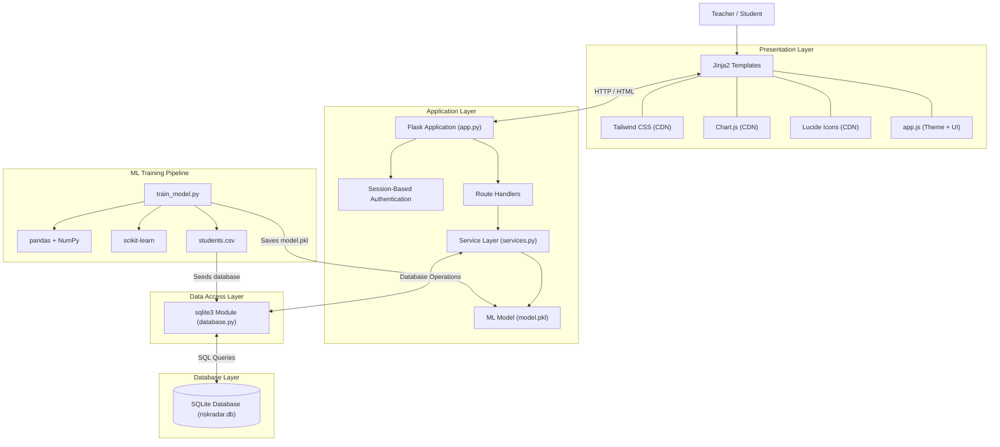
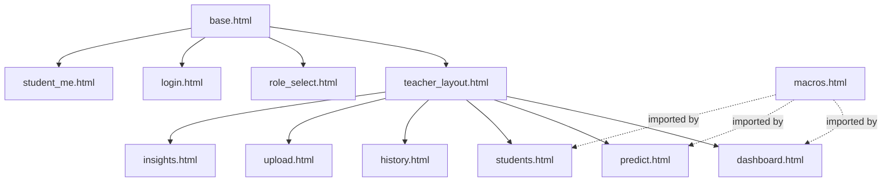
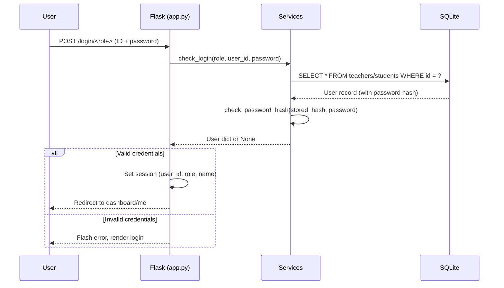
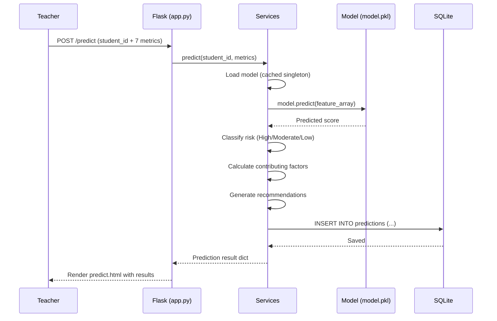
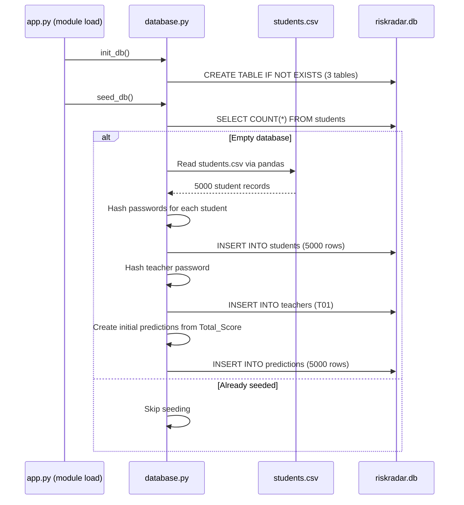

# RISKRADAR
# SYSTEM ARCHITECTURE DOCUMENT

**Project Name:** RiskRadar – Student Performance Prediction & Academic Risk Detection System  
**Team Members:** Ronit Pednekar, Manas Parab, Usman Khan  
**Programme:** MSc Integrated Data Science — SEM 5  
**Subject:** Software Engineering  
**Institution:** Goa University  
**Document Version:** 1.0  
**Date:** 18 November 2026

---

# 1. INTRODUCTION

## 1.1 Purpose

This document describes the system architecture of RiskRadar. It explains the application's major components, their responsibilities, the technologies used, and the interactions between the frontend, backend, database, and machine learning subsystems.

## 1.2 Scope

RiskRadar is a web-based student performance prediction and academic risk detection system that enables university faculty to predict student academic performance using machine learning.

The system provides:

- Role-based authentication for teachers and students.
- Teacher dashboard with risk distribution statistics.
- ML-powered student performance prediction using Random Forest Regression.
- Student roster management with search, filter and sort.
- Individual student performance history tracking.
- CSV roster upload with column validation.
- Model insights and feature importance visualization.
- Student self-service performance view.
- Dark mode and light mode support.

# 2. ARCHITECTURAL OVERVIEW

RiskRadar follows a monolithic web application architecture. The Flask backend serves Jinja2 templates directly to the browser, handling authentication, business logic, prediction and database operations within a single application process.

The architecture is divided into the following layers:

1. Presentation Layer (Jinja2 Templates + Tailwind CSS + Chart.js).
2. Application Layer (Flask Routes).
3. Service Layer (Business Logic + ML Inference).
4. Data Access Layer (sqlite3 Module).
5. Database Layer (SQLite).
6. ML Training Pipeline (scikit-learn + pandas).

# 3. SYSTEM ARCHITECTURE DIAGRAM

The following diagram represents the overall architecture of RiskRadar.



# 4. ARCHITECTURAL COMPONENTS

## 4.1 Presentation Layer

The presentation layer provides the user interface through which teachers and students interact with RiskRadar.

It is developed using:

- Jinja2 for server-side HTML templating.
- Tailwind CSS (CDN) for utility-first styling with dark mode support.
- Chart.js (CDN) for donut, line and bar chart visualizations.
- Lucide Icons (CDN) for iconography.
- Inter font (Google Fonts) for typography.
- Vanilla JavaScript (app.js) for theme toggle, toast auto-dismiss and sidebar toggle.

The frontend provides the following interfaces:

| Template | Purpose |
|---|---|
| base.html | Base layout with CDN imports, theme script, toast container |
| macros.html | Reusable UI components (stat cards, risk badges, form inputs) |
| teacher_layout.html | Sidebar layout wrapper for teacher pages |
| role_select.html | Landing page for role selection |
| login.html | Authentication page for both roles |
| dashboard.html | Teacher dashboard with statistics and donut chart |
| predict.html | Prediction form, results, contributing factors, recommendations |
| students.html | Searchable, filterable, sortable student roster |
| history.html | Individual student prediction history with line chart |
| upload.html | Drag-and-drop CSV upload with preview |
| insights.html | Model insights with feature importance bar chart |
| student_me.html | Student self-service performance view |

The template inheritance hierarchy is:



## 4.2 Application Layer

The application layer is developed using Python and Flask.

The main application entry point is:

`app.py`

The Flask application registers 10 route handlers:

| Route | Method | Purpose |
|---|---|---|
| `/` | GET | Landing page with role selection |
| `/login/<role>` | GET, POST | Authentication for teacher or student |
| `/teacher` | GET | Teacher dashboard |
| `/predict` | GET, POST | Student performance prediction |
| `/students` | GET | Student roster |
| `/history/<student_id>` | GET | Individual student history |
| `/upload` | GET, POST | CSV roster upload |
| `/insights` | GET | Model insights |
| `/me` | GET | Student self-service view |
| `/logout` | GET | Session termination |

The application layer also handles:

- Flask session configuration with a secret key.
- Database initialization and seeding at module load.
- Template context passing for Jinja2 rendering.
- Flash message generation for user feedback.

## 4.3 Authentication and Authorization

RiskRadar uses Flask session-based authentication.

The authentication system includes:

- Password hashing using werkzeug.security.generate_password_hash.
- Password verification using werkzeug.security.check_password_hash.
- Flask session creation on successful login.
- Session storage of user_id, role and name.
- Role-based access control via login_required(role) decorator.
- Session termination on logout.

The login_required decorator checks:

1. Whether a user_id exists in the Flask session.
2. Whether the session role matches the required role.
3. Redirects to the appropriate page if either check fails.

Teachers are authenticated against the `teachers` table and students against the `students` table.

## 4.4 Service Layer

The service layer (services.py) contains reusable business logic separated from route handlers.

The service functions are:

| Function | Purpose |
|---|---|
| `check_login(role, user_id, password)` | Authenticates teacher or student credentials |
| `get_students()` | Retrieves all students with their latest prediction scores |
| `get_dashboard_stats()` | Aggregates risk distribution counts and recent predictions |
| `predict(student_id, metrics)` | Runs ML model inference, classifies risk, saves to database |
| `get_history(student_id)` | Retrieves prediction history for a specific student |
| `get_latest(student_id)` | Retrieves the most recent prediction for a student |
| `validate_roster(columns)` | Validates required CSV columns for roster upload |

The predict function:

1. Loads the trained model from model.pkl (cached via global singleton).
2. Constructs a feature array from 7 input metrics.
3. Runs model.predict() to generate a predicted score.
4. Classifies the score into risk categories.
5. Calculates contributing factors using feature importances.
6. Generates personalized academic recommendations.
7. Saves the prediction record to the database.

## 4.5 Data Access Layer

Python's built-in sqlite3 module is used for database interaction.

The data access layer (database.py) provides:

- `get_db()` — Returns a database connection with Row factory and WAL journal mode.
- `init_db()` — Creates tables if they do not exist.
- `seed_db()` — Seeds the database from students.csv on first startup.

Database connections are opened per-request within service functions. The Row factory enables dictionary-style access to query results.

WAL (Write-Ahead Logging) journal mode is enabled for improved concurrent read performance.

## 4.6 Database Layer

SQLite is used as the embedded relational database.

The RiskRadar database (riskradar.db) contains three tables:

| Table | Purpose |
|---|---|
| teachers | Teacher accounts with hashed passwords |
| students | Student records with demographic and academic information |
| predictions | Prediction history with scores, risk levels and contributing factors |

The database structure is documented separately in:

`docs/database_design_and_erd.md`

## 4.7 ML Training Pipeline

The ML training pipeline (train_model.py) is a standalone script that:

1. Loads the students.csv dataset using pandas.
2. Performs Exploratory Data Analysis (EDA).
3. Selects 7 features and the target variable (Total_Score).
4. Splits data 80/20 for training and testing.
5. Trains a RandomForestRegressor with 200 trees and max depth 15.
6. Evaluates the model (MAE, RMSE, R²).
7. Computes feature importances.
8. Serializes the model to model.pkl using joblib.

The trained model is loaded at runtime by the service layer for predictions.

# 5. DATA FLOW

## 5.1 Authentication Flow



## 5.2 Prediction Flow



## 5.3 Dashboard Flow

1. Teacher navigates to /teacher.
2. Flask calls get_dashboard_stats().
3. Service queries SQLite for risk distribution counts and recent predictions.
4. Flask passes statistics to dashboard.html template.
5. Jinja2 renders the HTML with statistics.
6. Chart.js renders the donut chart using inline JSON data.

## 5.4 Student Roster Flow

1. Teacher navigates to /students.
2. Flask calls get_students().
3. Service executes a JOIN query between students and their latest prediction.
4. Flask passes the student list to students.html template.
5. Jinja2 renders the student table.
6. Client-side JavaScript enables search, filter and sort.

## 5.5 Database Seeding Flow



# 6. TECHNOLOGY STACK

The following technologies are used in the RiskRadar application:

| Component | Technology |
|---|---|
| Backend Framework | Flask |
| Templating Engine | Jinja2 |
| Programming Language | Python 3.12+ |
| Database | SQLite |
| CSS Framework | Tailwind CSS (CDN) |
| Charting Library | Chart.js (CDN) |
| Icon Library | Lucide Icons (CDN) |
| Font | Inter (Google Fonts) |
| ML Algorithm | RandomForestRegressor (scikit-learn) |
| Model Serialization | joblib |
| Data Processing | pandas, NumPy |
| Password Hashing | werkzeug.security |
| Client-side JavaScript | Vanilla JS |
| Version Control | Git |

## 6.1 Machine Learning Components

The ML training pipeline uses:

- pandas for dataset loading and manipulation.
- NumPy for numerical operations.
- scikit-learn for model training and evaluation.
- RandomForestRegressor with 200 trees and max depth 15.
- joblib for model serialization to model.pkl.

The trained model provides:

- Real-time score prediction from 7 academic metrics.
- Feature importance values for contributing factor analysis.
- Risk classification based on predicted score thresholds.

# 7. DEPLOYMENT AND EXECUTION ENVIRONMENT

During local development, the RiskRadar application is executed using the Flask development server.

The local development address is:

| Component | Address |
|---|---|
| Flask Application | http://127.0.0.1:5002 |

The application can be started using:

```bash
python app.py
```

Or using the provided run.command double-click launcher on macOS.

SQLite is an embedded database that requires no separate server process. The database file (riskradar.db) is created automatically on first startup.

The model.pkl file must be present in the application directory for predictions to work. It can be regenerated by running train_model.py.

# 8. SECURITY CONSIDERATIONS

The architecture incorporates the following security measures:

1. Passwords are hashed using werkzeug.security.generate_password_hash before storage.
2. Password verification uses werkzeug.security.check_password_hash (timing-safe comparison).
3. Flask sessions maintain authentication state server-side.
4. The login_required decorator enforces role-based access control.
5. Teacher and student routes are separated by role.
6. Database queries use parameterized statements to prevent SQL injection.
7. Flask's secret_key is configured for session signing.
8. The .gitignore excludes the database file and environment files.

# 9. PROJECT FILE STRUCTURE

```
student_performance_prediction/
├── app.py                  # Flask application and route handlers
├── database.py             # SQLite connection, schema, seeding
├── services.py             # Business logic and ML inference
├── train_model.py          # EDA, model training, evaluation
├── mock.py                 # Contract/fallback with function signatures
├── model.pkl               # Trained Random Forest model (60 MB)
├── students.csv            # Dataset: 5000 students, 23 columns
├── riskradar.db            # SQLite database (auto-generated)
├── requirements.txt        # Python dependencies
├── run.command             # macOS double-click launcher
├── .gitignore              # Git exclusions
├── static/
│   └── app.js              # Theme toggle, toast, sidebar JS
├── templates/
│   ├── base.html           # Base layout
│   ├── macros.html         # Reusable UI components
│   ├── teacher_layout.html # Sidebar layout for teacher pages
│   ├── role_select.html    # Landing page
│   ├── login.html          # Authentication
│   ├── dashboard.html      # Teacher dashboard
│   ├── predict.html        # Prediction form and results
│   ├── students.html       # Student roster
│   ├── history.html        # Student history
│   ├── upload.html         # CSV upload
│   ├── insights.html       # Model insights
│   └── student_me.html     # Student performance view
└── docs/
    ├── SRS.md
    ├── sdlc_v_model.md
    ├── system_architecture.md
    ├── database_design_and_erd.md
    ├── functional_testing_report.md
    ├── performance_testing_report.md
    └── final_project_report.md
```

# 10. CONCLUSION

RiskRadar uses a monolithic Flask architecture that integrates server-side templating, session-based authentication, SQLite persistence, and scikit-learn ML inference within a single application process.

The Jinja2 presentation layer provides 12 responsive templates styled with Tailwind CSS and enhanced with Chart.js visualizations. The service layer separates business logic from route handlers, and the ML training pipeline operates independently to produce the serialized model.

This architecture supports the core features of student performance prediction, risk classification, dashboard analytics, and role-based access for both teachers and students.

---

**END OF DOCUMENT**
